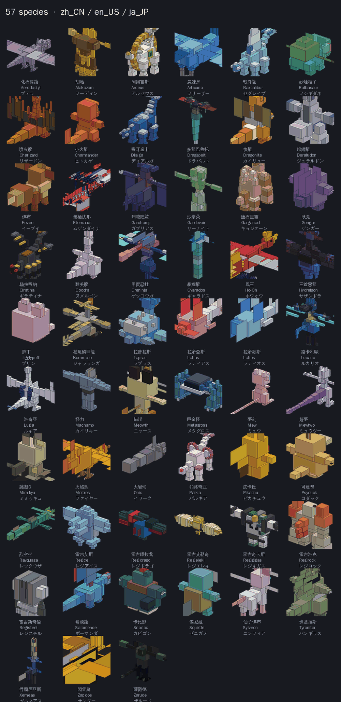
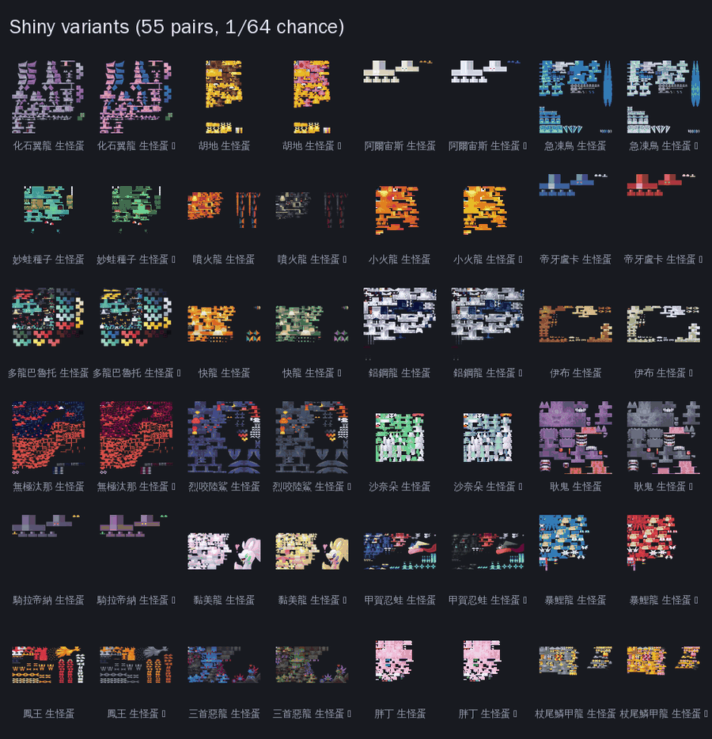
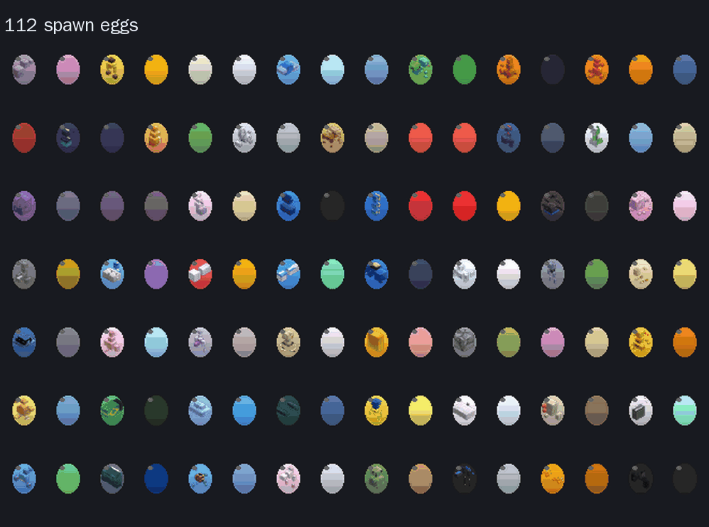
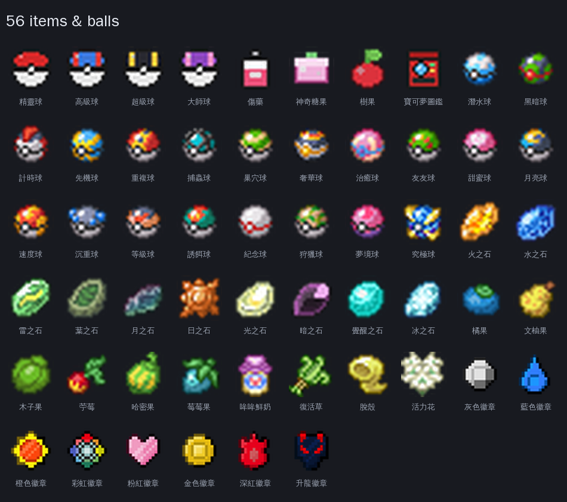

# 10w Pokémon Bedrock Add-on

一個給 **Minecraft Bedrock / 基岩版**（含 Nintendo Switch、手機、Windows）用的寶可夢 add-on：
自架伺服器即可玩，**不需要市集、不需要 2GB 存檔限制的繞道**，支援多人同時在線。

以 **行為包（Behavior Pack）+ 資源包（Resource Pack）** 組合實作，腳本全部使用 Bedrock 官方
Script API（`@minecraft/server`），沒有依賴任何外部模組載入器。

> 專案性質：**非商業同人作品**。寶可夢角色與名稱的權利屬 Nintendo / Creatures / GAME FREAK，
> 模型與貼圖來自開源專案（CC 授權，含非商業條款）。詳見 [授權與致謝](#授權與致謝)。



---

## 截圖 / Screenshots / スクリーンショット

以下圖片**全部由包內素材自動生成**（`tools/gen_docs_images.py`），不是模擬圖也不是手繪示意——
你看到的貼圖、蛋圖示、圖鑑頭像就是遊戲裡實際載入的檔案。

### 全部 57 種寶可夢


57 種基礎型，每格上方是**圖鑑頭像**（由方塊模型渲染）＋ 繁體中文 / English / 日本語 三種名稱——
下方那張圖示就是遊戲內圖鑑 GUI 左側顯示的同一個檔案。含 24 隻經典人氣角色、13 隻大型傳說、
以及 20 隻後來追加的傳說與準傳說（三聖鳥、雷吉五兄弟、班基拉斯、暴飛龍、巨金怪、三首惡龍…）。

### 異色（Shiny）對照



55 組異色對照（左為本體、右為 ✦ 異色）。異色在遊戲中是**獨立實體型別**（`poke:<id>_shiny`），
自然生成機率 **1/64**，有自己的貼圖、生怪蛋與三語名稱。

### 112 個生怪蛋



每個蛋的圖示是用該寶可夢的 3D 頭像等角投影合成蛋殼後畫出來的，手持右鍵即可召喚。
蛋的名稱寫在資源包 `lang` 的 `item.spawn_egg.entity.poke:<id>.name`。

### 精靈球與道具



28 種球（含大師球、究極球、狩獵球…）、10 種進化石、6 種樹果、8 枚徽章，共 56 種道具。

> 想看實際遊戲畫面（夥伴跟隨、捕捉演出、傳送廣場）：歡迎提 issue 或 PR 補上你自己的截圖，
> 我會放在這一節。

---

## 目前規模

| 項目 | 數量 |
|---|---|
| 寶可夢基礎型 | **57 種** |
| 實體型別（含異色） | **112 個** |
| 高精度模型（cobblemon 移植） | 51 種，其餘為程序化方塊模型 |
| 動畫 | 走路 / 待機 / 攻擊 / 飛行，共 58 個動畫檔 |
| 生怪蛋 | 112 個（含異色），附圖示與三語名稱 |
| 圖鑑頭像 | 112 張 |
| 精靈球 | 28 種（含大師球、究極球等） |
| 其他道具 | 28 種（傷藥、神奇糖果、進化石、樹果、徽章…） |
| 裝飾方塊 | 7 種（治療台、電腦、寶可夢絨 5 色） |
| 語言 | 繁體中文 `zh_CN` / English `en_US` / 日本語 `ja_JP` |

完整物種表見 **[docs/SPECIES.md](docs/SPECIES.md)**。

## 特色

- **捕捉系統**：手持精靈球投擲，依血量、狀態、球種計算捕獲率，附捕捉演出與音效
- **夥伴系統**：捕獲或召喚後自動跟隨（原生 AI 尋路），距離過遠會補位，空中不亂跳
- **主動戰鬥**：夥伴會主動攻擊敵對生物，攻擊有揮擊動畫（以 `poke:attack` 實體屬性觸發客戶端動畫）
- **招式與屬性克制**：24 個招式、完整屬性相剋表
- **圖鑑 GUI**：分頁瀏覽、左側頭像、可直接召喚夥伴
- **異色（Shiny）**：1/64 機率自然生成，獨立實體型別，附專屬貼圖與名稱
- **生怪蛋**：每隻都有自繪蛋圖示（3D 頭像合成蛋殼），三語名稱
- **飛行寶可夢**：10 隻傳說改用飛行導航（`navigation.fly` + `float_wander`），會在空中盤旋
- **傳送廣場**：踩上傳送台切換主題世界（寶可夢樂園 / 創造建築樂園 / 生存冒險 / 家裡的 Minecraft）
- **多世界大廳**：BedrockConnect 當大廳，後面接多個獨立世界容器

## 安裝

### 方式一：單一世界（最簡單）

1. 把 `packs/pokemon/bp` 和 `packs/pokemon/rp` 分別複製到世界的
   `behavior_packs/pokemon_bp` 與 `resource_packs/pokemon_rp`
2. 編輯世界設定，把兩個包都啟用（RP 版本要跟 BP `dependencies` 一致）
3. 進世界後執行 `/scriptevent` 相關指令前，先給自己 op

### 方式二：專用伺服器（推薦，多人）

使用 [itzg/minecraft-bedrock-server](https://github.com/itzg/docker-minecraft-bedrock-server) 或官方 BDS：

```bash
# 目錄結構
data/
├── behavior_packs/pokemon_bp/      # 本專案的 bp/
├── resource_packs/pokemon_rp/      # 本專案的 rp/
└── worlds/<world_name>/
    ├── world_behavior_packs.json   # 指向 pokemon_bp 的 uuid + 版本
    └── world_resource_packs.json   # 指向 pokemon_rp 的 uuid + 版本
```

`world_*_packs.json` 範例：

```json
[{ "pack_id": "b3ca5287-acf7-577e-b046-bca0babb7e6d", "version": [4, 9, 0] }]
[{ "pack_id": "3a0c853a-258b-5980-ad0b-1ee17cfd3c54", "version": [4, 9, 0] }]
```

> **RP 與 BP 的版本號必須一致**（BP `manifest.json` 的 `dependencies` 要對上 RP 的 uuid + version），
> 否則伺服器會出現 `Configured pack ... was not found and was ignored`，世界裡看不到模型。

### 客戶端注意

- 第一次進入（或包版本更新後）客戶端要下載整個資源包，**包越大越容易超時**。
  本專案已把 JSON 去空白、PNG 量化到 256 色，把包壓在 4MB 以內；若首次連線失敗，重試一次即可。
- Switch 上透過自訂 DNS 導向自架伺服器即可（本專案不含這部分工具）。

## 玩法

| 操作 | 說明 |
|---|---|
| 手持精靈球右鍵 | 投球捕捉（血量越低成功率越高） |
| 手持生怪蛋右鍵 | 召喚該寶可夢 |
| 手持圖鑑右鍵 | 開啟圖鑑 GUI，可查看並召喚夥伴 |
| 召喚夥伴 | 自動跟隨、主動打怪 |
| 治療台 / 電腦 | 裝飾與互動方塊 |
| 傳送台 | 踩上去傳送到對應主題世界 |

常用指令：

```mcfunction
/summon poke:rayquaza            # 召喚（建議先開 tickingarea）
/tickingarea add 0 100 0 16 100 16 pokearea
/testfor @e[type=poke:charizard] # 檢查實體
```

## 目錄結構

```
packs/pokemon/
├── bp/                        # 行為包
│   ├── entities/*.json        # 112 個實體定義（AI、數值、生成蛋）
│   ├── items/*.json           # 精靈球與道具
│   ├── blocks/*.json          # 裝飾方塊
│   ├── spawn_rules/*.json     # 自然生成規則（依生態域）
│   ├── scripts/
│   │   ├── main.js            # 主腳本：捕捉 / 夥伴 / 招式 / 圖鑑 / 異色
│   │   └── worlds.js          # 傳送廣場與主題世界
│   ├── texts/                 # zh_CN / en_US / ja_JP
│   └── manifest.json
└── rp/                        # 資源包
    ├── models/entity/         # 高精度模型 + 程序化模型
    ├── animations/            # 走路 / 待機 / 攻擊 / 飛行
    ├── entity/*.entity.json   # 客戶端實體綁定（模型、貼圖、動畫、生怪蛋圖示）
    ├── textures/              # 實體貼圖、蛋圖示、圖鑑頭像、物品圖示
    ├── items/                 # 物品客戶端定義
    ├── texts/                 # zh_CN / en_US / ja_JP
    ├── licenses/              # 每個匯入模型的上游授權檔
    └── manifest.json
```

## 建置管線

`tools/` 是可重複執行的產生器，改完規格重跑即可重建整個包：

```bash
python3 tools/gen_pokemon.py -o packs/pokemon            # 實體 / 生怪規則 / 語言 / manifest
python3 tools/import_cobblemon_models.py packs/pokemon   # 從上游下載模型與貼圖
python3 tools/import_cobblemon_poses.py  packs/pokemon   # 匯入姿勢動畫（脖子/頭的基準姿態）
python3 tools/import_cobblemon_anims.py  packs/pokemon   # 匯入走路 / 待機 / 攻擊 / 飛行
python3 tools/fix_models_anim.py packs/pokemon/rp        # 為程序化模型生成動畫
python3 tools/gen_shiny_procedural.py packs/pokemon/rp   # 程序化物種的異色貼圖
python3 tools/gen_pokemon_extra.py packs/pokemon assets  # 異色實體 / 道具 / 方塊
python3 tools/gen_egg_icons.py packs/pokemon/rp          # 生怪蛋圖示
python3 tools/gen_dex_icons.py packs/pokemon/rp          # 圖鑑頭像
python3 tools/wire_attack.py packs/pokemon               # 攻擊動畫屬性
python3 tools/gen_rp_items.py packs/pokemon              # RP 物品定義與圖示映射
python3 tools/gen_egg_names.py packs/pokemon             # 生怪蛋名稱（三語）
python3 tools/gen_lang.py packs/pokemon                  # 產生完整的 en_US / ja_JP
python3 tools/validate_js.py packs/pokemon/bp/scripts/main.js   # 語法與 TDZ 檢查
```

**順序不能亂**：`import_cobblemon_models` 會用上游幾何覆蓋程序化模型，
`fix_models_anim` 要在之後才能依真實骨骼生成動畫。

## 授權與致謝

| 內容 | 授權 |
|---|---|
| 本專案的腳本、工具、生怪蛋圖示、圖鑑頭像、世界生成、方塊與道具圖示 | **MIT**（見 [LICENSE](LICENSE)） |
| 寶可夢模型與貼圖（`rp/models/entity/cobblemon/`、`rp/textures/entity/pokemon/`） | 來自 [kirbycope/cobblemon-bedrock](https://github.com/kirbycope/cobblemon-bedrock)，**CC 授權（含非商業條款）**，逐物種授權見 `packs/pokemon/rp/licenses/` |
| 寶可夢角色、名稱、設計 | © Nintendo / Creatures Inc. / GAME FREAK Inc. |

原始模型與貼圖我們未做修改，只調整 client entity 綁定（identifier 改為 `poke:*`）並加上自己的行為、
招式、生成規則與動畫綁定。上游致謝見 [`packs/pokemon/rp/CREDITS.md`](packs/pokemon/rp/CREDITS.md)。

## 法律聲明

本專案是**非商業同人作品**，與 Nintendo / Creatures / GAME FREAK / Microsoft / Mojang 均無關聯，
亦未獲其授權或背書。

- 請勿用於任何商業用途（販售、課金、贊助解鎖、Minecraft Marketplace 上架）
- 模型與貼圖的 CC 授權含 **非商業（NonCommercial）** 條款，商業使用即違反授權
- 寶可夢 IP 的散布在部分司法管轄區可能構成侵權，使用者需自行承擔風險

如果你想做**可合法上架**的版本，方向是把角色與模型換成原創生物——本專案的行為包架構（捕捉、夥伴 AI、
圖鑑、多世界傳送）與 IP 無關，可以直接套用。

---

## English

A **Pokémon add-on for Minecraft Bedrock Edition** (Switch / mobile / Windows) designed for
self-hosted servers — no Marketplace, no 2GB world-size workaround, multiplayer ready.

- **57 species, 112 entity types** (incl. shiny variants), 51 high-detail cobblemon-port models
- Capture with 28 ball types, partner AI that follows and fights, 24 moves with a type chart
- In-game Pokédex GUI, custom spawn-egg icons, 1/64 shiny rate
- Flying legendaries use real flight navigation and hover in the air
- Teleport plaza connecting multiple themed worlds through a BedrockConnect lobby
- **Localized in `zh_CN`, `en_US` and `ja_JP`**


Screenshots above are generated from the pack's own textures (`tools/gen_docs_images.py`) —
see the [Screenshots](#截圖--screenshots--スクリーンショット) section for the full set.

Install: drop `packs/pokemon/bp` and `packs/pokemon/rp` into `behavior_packs/` and `resource_packs/`,
enable both in the world settings (keep RP/BP versions in sync), then `/summon poke:pikachu`.

Build: the `tools/` scripts regenerate the whole pack from specs — see the pipeline section above.

**License**: scripts and tools **MIT**; Pokémon models/textures are CC-licensed with a
**NonCommercial** clause from [kirbycope/cobblemon-bedrock](https://github.com/kirbycope/cobblemon-bedrock);
Pokémon characters are © Nintendo / Creatures / GAME FREAK. **This is a non-commercial fan project.**
Do not sell it or publish it on Minecraft Marketplace.

## 日本語

Minecraft **統合版（Switch / スマホ / Windows）向けのポケモンアドオン**です。自前サーバーで動かす前提で、
マーケットプレイスも 2GB のワールド制限回避も不要、マルチプレイに対応しています。

- **57 種 / 112 エンティティ**（色違い含む）、うち 51 種は cobblemon 移植の高精度モデル
- 28 種類のボールで捕獲、なかまは自動でついてきて戦う、わざ 24 種とタイプ相性
- 図鑑 GUI、タマゴのアイコン、色違いは 1/64
- 飛ぶ伝説のポケモンは実際に空中を移動・ホバリングします
- テレポート広場から複数のテーマワールドへ移動（BedrockConnect ロビー経由）
- **`zh_CN` / `en_US` / `ja_JP` の 3 言語対応**

画像はパック内のテクスチャから自動生成したものです（`tools/gen_docs_images.py`）。
一覧は[スクリーンショット](#截圖--screenshots--スクリーンショット)の節にあります。

導入は `packs/pokemon/bp` と `packs/pokemon/rp` をそれぞれ `behavior_packs/` と `resource_packs/` に置き、
ワールド設定で両方を有効化するだけです（RP と BP のバージョンは必ず揃えてください）。

**ライセンス**：スクリプトとツールは **MIT**。ポケモンのモデル・テクスチャは
[kirbycope/cobblemon-bedrock](https://github.com/kirbycope/cobblemon-bedrock) 由来の
**CC ライセンス（非商用条項あり）**。ポケモンは © Nintendo / Creatures / GAME FREAK。
本プロジェクトは**非商用のファンメイド**であり、販売や Marketplace への公開は行えません。

---

## 更新記錄 / Changelog

### v5.0.32

- **圖鑑頭像修復**：`BASE_IDS` 存的是完整實體 ID（`poke:pikachu`），拼貼圖路徑時沒有去掉前綴，
  實際送出的路徑變成 `textures/items/dex_poke:pikachu`，因此全部顯示成缺圖的紫紅方格。
  現在拼路徑前先 `replace(/^poke:/, "")`，108 張頭像正常顯示。
- **圖鑑改為單頁**：57 種一次列完，不再分頁。
- **尾巴火焰改為腳本發射**：不再依賴資源包動畫的 locator，行為包每 0.3 秒在小火龍／噴火龍尾部
  呼叫 `minecraft:basic_flame_particle`；小火龍偏移 0.62 格後 / 0.78 格高，噴火龍 0.80 / 1.15。
- **資源包瘦身**：移除重複的 `textures/ui/dex_*`、`portrait_*` 共 228 張，JSON 全量 minify，
  授權文件移出包外（`docs/licenses/`），8.1MB → 6.2MB，降低首次進服下載失敗機率。
- **診斷指令**：`/scriptevent poke:icontest`、`poke:dexprobe`、`poke:chain`、`poke:flametest`
  可在遊戲內逐一驗證貼圖與粒子。

### v5.0.0

- 六隻程序生成模型重製：阿爾宙斯、帝牙盧卡、帕路奇亞、騎拉帝納、戟脊龍、鹽石巨靈
- 圖鑑縮圖改為真正等角投影渲染（128×128 RGBA）
